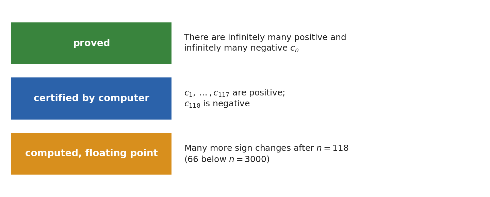

DOI of this text: [doi:10.5281/zenodo.24577183](https://doi.org/10.5281/zenodo.24577183)

This is an introductory text to the research paper *Sign changes of Keiper-Li second differences* [[Per26]](https://doi.org/10.5281/zenodo.24447746), by the same author. The paper has the proofs and the full computations. This note has the idea. No equations are needed to follow it. It makes no claim the paper does not make, and it says which claims are proved, which are certified by computer with error bars, and which are only computed.

One caution comes first, because the paper itself puts it first. The paper is about the sign of a certain sequence of numbers. It does not prove the Riemann hypothesis and it does not disprove it. Neither result contradicts the Riemann hypothesis or Li's criterion, which concern the sign of the Li coefficients themselves, not of the sequence studied here.

> **Status as of 27 November 2026:** on 20 November 2026 Levent Alpöge announced a proof of the Riemann hypothesis, found with Claude and released as a Lean 4 formalization of about 17 million lines, which the Lean FRO and the Mathlib Initiative certified on 21 November after checks by the Lean kernel and independent checkers; no complete human-readable proof has been published and no peer review by mathematicians has been reported, so the proof is machine-checked and human verification is still under way. Both results of this paper are unconditional: they assume neither the Riemann hypothesis nor any independence hypothesis, so they hold whether or not that proof is accepted. This note takes no side on the announced proof, and says neither that the Riemann hypothesis is open nor that it is proved.

# A list of numbers that knows about the zeta function

The Riemann zeta function has famous zeros, and the Riemann hypothesis (RH) says that they all lie on one straight line. A proof was announced on 20 November 2026 (see the status above). Over the years, many different statements have been shown to be equivalent to it. One of them, due to Xian-Jin Li, is about a list of numbers $\lambda_1, \lambda_2, \lambda_3, \dots$, the **Li coefficients**. Each one is computed from the zeros of zeta. **Li's criterion** says that RH is true if and only if every number in the list is at least zero.

The first values are small and positive, and they grow slowly. Think of the list as the heights of points on a curve. To the eye, the curve climbs smoothly and bends upward like a bowl. Two things are worth keeping apart. The **sign of the numbers themselves** is what Li's criterion is about. The **bend of the curve** is a different question, and it is the one of this paper.

# The bend of a curve

How do you measure the bend of a curve made of points? Take three neighbours. If the middle one lies below the straight line between the other two, the curve bends upward there, like a bowl. If it lies above, the curve bends downward, like a hill. The number that records this is the **second difference**: the right neighbour, plus the left neighbour, minus twice the middle one. The paper calls it $c_n$.

- If $c_n$ is positive, the curve bends upward at the point $n$.
- If $c_n$ is negative, the curve bends downward there.

The sequence $c_n$ is not new. Keiper studied it in 1992, and showed that if RH is true, then all the $c_n$ stay small, never larger than about $0.046$ in size. Conversely, if they stay bounded, RH is true. Keiper did not say anything about the **sign** of $c_n$. Later, Xiao studied the same sequence and made a natural conjecture: from the second term on, every $c_n$ is positive. In other words, the curve of Li coefficients always bends upward.

There was good reason to believe it. The first values $c_1, c_2, c_3, \dots$ are all positive, and a picture of the Li coefficients looks like a bowl.

# What is proved: the bend must flip, forever

The first result, Theorem 1 of the paper, is that Xiao's conjecture is false, and for a reason that does not need a computer. It is **proved** that $c_n$ is positive for infinitely many $n$ and negative for infinitely many $n$. The proof assumes nothing about where the zeros of zeta lie. It holds whether RH is true or not.

The idea fits in a few lines. Put all the numbers $c_n$ into one function, as the coefficients of a power series. A power series lives on a disc, and the edge of the disc is set by the nearest singular point of the function. For this function the singular points come from the zeros of zeta, and they lie on or near a circle of radius one. Now suppose the $c_n$ were eventually all positive (or all negative). A classical theorem of Pringsheim says that a power series with positive coefficients must be singular at the point where its disc ends on the positive axis. But along the stretch of the positive axis in question the function is perfectly smooth. The paper checks this by a short comparison of how fast the function can grow near a singular point and how fast it can grow along that stretch. The two do not match, so the signs cannot settle down. The argument is classical, in the spirit of a theorem of Landau on sign changes, and the paper claims no novelty beyond the statement.

{width=92%}

The paper adds a second proof of the same statement, which splits into two cases, RH false and RH true, and reaches the same conclusion in each. So Theorem 1 holds on both sides of the great question. It does not tell us where the first negative value is. That is the second result.

# What is certified: the first flip is at $n = 118$

The second result, Theorem 2, is a finite computation, certified by computer. It says that $c_1, c_2, \dots, c_{117}$ are all positive, and that $c_{118}$ is negative, about $-0.000271$. So Xiao's conjecture holds for a long time, 117 steps, and then fails. (In Xiao's own numbering the first failure is at 119, because he counts one step later.)

The word **certified** means that every number in the computation is carried together with a rigorous band of error, a method called interval arithmetic. The computer does not print a decimal that looks right. It proves, step by step, that each value lies inside a stated interval. For $c_{118}$ the paper gives the interval between $-2.71044467117 \cdot 10^{-4}$ and $-2.71044467115 \cdot 10^{-4}$. The error of the approximation used in the computation is smaller than $10^{-160}$.

{width=92%}

The wave in the picture is the whole story. Each zero of zeta contributes a small rotating term to $c_n$, and together these terms add up to a slowly oscillating sequence. At first the upward push wins. Then the oscillation drags the sequence below zero, and it keeps going up and down.

{width=92%}

# How the result was checked

The certificate is a short program that uses only the standard library of Python. It runs in about a second, and it was run twice with different settings, which agree. The error bounds were derived by hand in an appendix of the paper, and the program adds them to its numbers before it does anything else.

A second, independent route uses a different arbitrary-precision library (Arb) and a different way to reach the coefficients. It confirms that $c_{118}$ is negative and that $c_2, \dots, c_{117}$ are positive. It does not cover $c_1$. It finds the value of $c_{118}$ with an error smaller than $10^{-800}$.

A third check is not a proof but a comparison. A public table of Li coefficients, computed by Johansson, gives for $c_{118}$ the value $-2.7104446711617 \cdot 10^{-4}$. That agrees with the certified value to 13 significant digits.

The paper says plainly that the program has not been reviewed by a third party and has not been formalised in a proof assistant. The result is computer-assisted, and it is labelled so.

# Beyond the first flip

After $n = 118$ the paper does not claim proofs, but a numerical remark. This is **computed**, in floating point, from the public table, and it is not certified. Up to $n = 3000$ the sign of $c_n$ changes 66 times. The first runs of constant sign begin at $n = 118$ (negative), $145$ (positive), $200$ (negative), $241$ (positive) and $293$ (negative). Over that range the largest value is about $0.046$, reached at $n = 1$, and the smallest is about $-0.017$.

{width=88%}

# What this note does not claim

It does not prove RH and it does not disprove it. The sign of $c_n$ is not the sign of the Li coefficients, and Li's criterion is about the second one. The paper itself notes that neither of its results contradicts RH or Li's criterion. It does not claim anything about where the zeros of zeta lie.

It does not say that the sign changes continue forever with a pattern. What is proved is only that both signs occur infinitely often. The count of 66 changes below $n = 3000$ is a computed observation.

It does not claim a complete survey of the literature. The paper lists what it searched, among them the work of Keiper, Xiao, Bombieri and Lagarias, Arias de Reyna, Voros, Maślanka, and Merlini, Sala and Sala. None of these states the sign behaviour of $c_n$, so, to the author's knowledge, both results are new. The paper says that its search was not exhaustive. The method of the first result is classical and elementary.

# Where to go next

- The paper itself [[Per26]](https://doi.org/10.5281/zenodo.24447746), with the proofs, the error bounds, the certificates and the scripts.
- The public code and certificates, at [github.com/mik-tf/keiper-li-second-differences](https://github.com/mik-tf/keiper-li-second-differences).

# Use of AI {-}

Claude (Anthropic) was used in November 2026, under the author's direction, for drafting, figures and checks.

# Read the research paper {-}

```{=latex}
\raggedright
```

The full paper, with the proofs, is *Sign changes of Keiper-Li second differences*, by Michaël Perreault.

DOI: [doi:10.5281/zenodo.24447746](https://doi.org/10.5281/zenodo.24447746)

```{=latex}
\par\ifdim\dimexpr\pagegoal-\pagetotal\relax<15\baselineskip\ifdim\pagetotal>0pt\newpage\fi\fi
```

# References {-}

[Per26] M. Perreault, *Sign changes of Keiper-Li second differences*, 2026, Zenodo. [doi:10.5281/zenodo.24447746](https://doi.org/10.5281/zenodo.24447746).
